# Filament – Instagram

[](https://packagist.org/packages/agenciafmd/filament-instagram)
[](LICENSE.md)

Integra o feed do Instagram ao Admix: adiciona ao painel um widget para (re)autorizar a conta e deixa os posts disponíveis para exibição no site.

A comunicação com a API do Instagram é feita pelo pacote [justbetter/laravel-instagram-feed](https://github.com/justbetter/laravel-instagram-feed).

## Requisitos

- PHP ^8.4
- Laravel ^12.0 | ^13.0
- Filament ^5.0
- agenciafmd/filament-admix v1.x-dev | dev-master
- justbetter/laravel-instagram-feed >=1.1.2

## Instalação

1. Instale o pacote via Composer:

```bash
composer require agenciafmd/filament-instagram:dev-master
```

2. Execute as migrações (criam as tabelas de perfil e de tokens do Instagram):

```bash
php artisan migrate
```

3. Crie o perfil do Instagram (`YourProfile` é o @ da conta que recebeu o convite de testador, ver [Integrações externas](#integrações-externas)):

```bash
php artisan instagram-feed:profile YourProfile
```

## Ativando no painel

Adicione o plugin na config do admix `config/filament-admix.php`:

```php
use Agenciafmd\Instagram\InstagramPlugin;

return [
    'plugins' => [
        InstagramPlugin::class,
    ],
];
```

O plugin não cria item de menu: ele registra o widget **Instagram** no dashboard, com o botão **Renovar token do Instagram**. O botão abre a rota `/instagram`, que redireciona para a autorização do primeiro perfil cadastrado. Após o login no Instagram, o callback volta para `/instagram-auth-success` (ou `/instagram-auth-failure` em caso de erro).

## Configuração

Arquivo: `config/filament-instagram.php`

```php
return [
    'name' => 'Instagram',
];
```

| Chave  | Padrão      | Descrição       |
|--------|-------------|-----------------|
| `name` | `Instagram` | Nome do pacote. |

O pacote também carrega a configuração `instagram-feed` (arquivo `config/instagram-feed.php` do próprio pacote):

| Chave                 | Padrão                         | Descrição                                                                                   |
|-----------------------|--------------------------------|---------------------------------------------------------------------------------------------|
| `client_id`           | `env('INSTAGRAM_CLIENT_ID')`   | Client ID do app criado no Meta for Developers.                                             |
| `client_secret`       | `env('INSTAGRAM_CLIENT_SECRET')` | Client Secret do app (não é o access token).                                              |
| `base_url`            | `null`                         | Base usada para montar a URL de callback. Quando `null`, usa o `APP_URL`.                   |
| `auth_callback_route` | `instagram/auth/callback`      | Rota que recebe o callback do OAuth. Deve estar cadastrada como redirect URI no app.        |
| `success_redirect_to` | `instagram-auth-success`       | Rota para onde o usuário é enviado quando a autorização dá certo.                           |
| `failure_redirect_to` | `instagram-auth-failure`       | Rota para onde o usuário é enviado quando a autorização falha.                              |
| `ignore_video`        | `false`                        | Remove vídeos do feed; carrosséis passam a usar a primeira imagem (ou são ignorados).       |
| `notify_on_error`     | `null`                         | E-mail notificado quando a atualização do feed falha.                                       |

Adicione as variáveis ao `.env`:

```dotenv
INSTAGRAM_CLIENT_ID=
INSTAGRAM_CLIENT_SECRET=
```

## Uso

O pacote agenda automaticamente os comandos do `laravel-instagram-feed` (é necessário o scheduler do Laravel rodando):

- `instagram-feed:refresh` — a cada hora, atualiza o feed em cache;
- `instagram-feed:refresh-tokens` — semanalmente, renova os tokens de acesso.

Para exibir os posts no site, busque o perfil e o feed:

```php
use JustBetter\InstagramFeed\Profile;

$feed = Profile::for('YourProfile')?->feed(12) ?? [];
```

Cada item é um `JustBetter\InstagramFeed\InstagramMedia`, com as propriedades `type`, `url`, `permalink`, `caption`, `timestamp`, `thumbnail_url` e `children`, e os métodos `isImage()`, `isVideo()` e `isCarousel()`:

```blade
@foreach ($feed as $post)
    <a href="{{ $post->permalink }}" target="_blank" rel="noopener noreferrer">
        isVideo() ? $post->thumbnail_url : $post->url }}" alt="{{ $post->caption }}">
    </a>
@endforeach
```

## Integrações externas

### Gerando as chaves

Com uma conta Facebook, vá em:

https://developers.facebook.com/apps/creation/

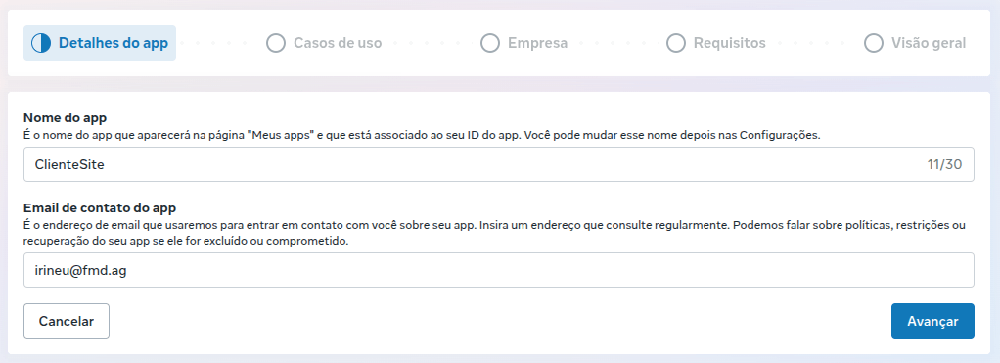

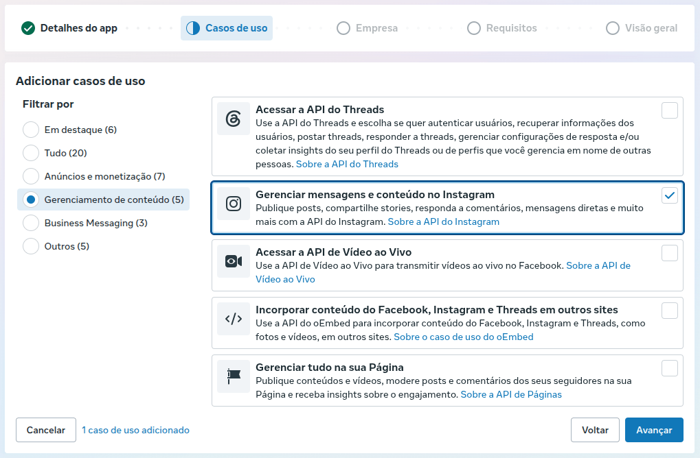

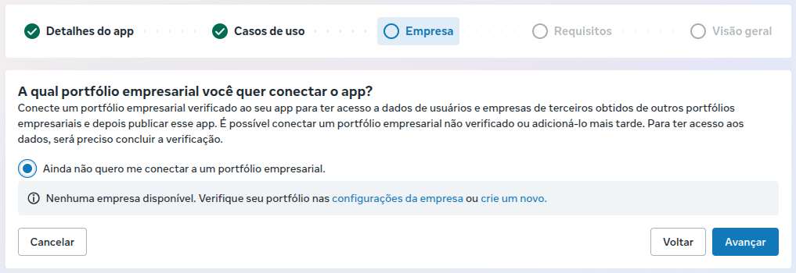

Depois do App Criado, na lateral, vá em

Casos de uso > Gerenciar mensagens e conteúdo no Instagram > Personalizar

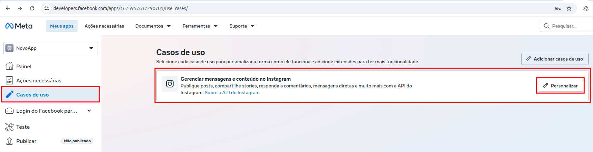

Aqui conseguimos o **Client ID** e **Client Secret**

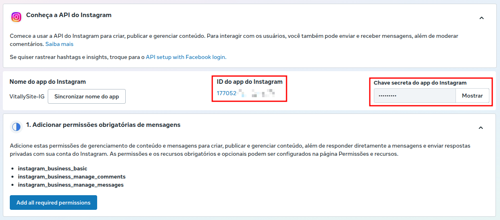

Desça até **Configurar o login da empresa no Instagram**

Clique em Configurar e adicione o callback de login.

Ela será https://{url-de-produção}/instagram/auth/callback

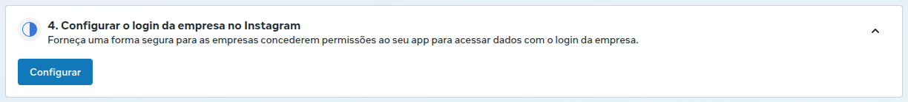

Uma vez adicionado o callback, volte no **Configurações do login da empresa** e adicione as urls dos outros ambientes.

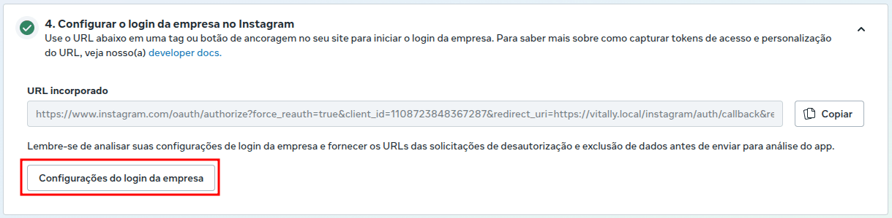

Vá agora em **Permissões e recursos** e ative as permissões:

- instagram_business_basic
- public_profile

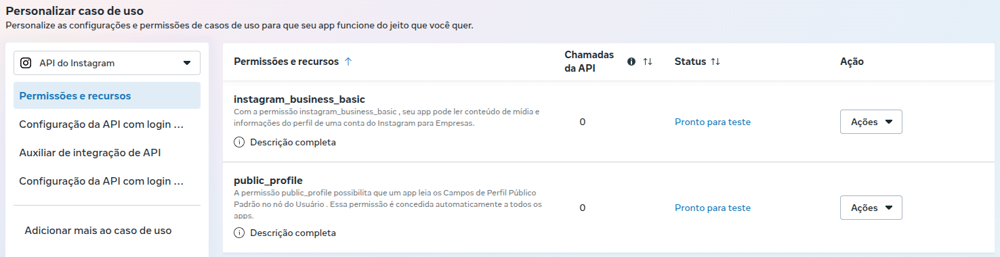

Em Configuração do app > Básico, preencha os campos obrigatórios.

> Atenção para Domínios do aplicativo, preencha com o ambiente local, homologação e produção.

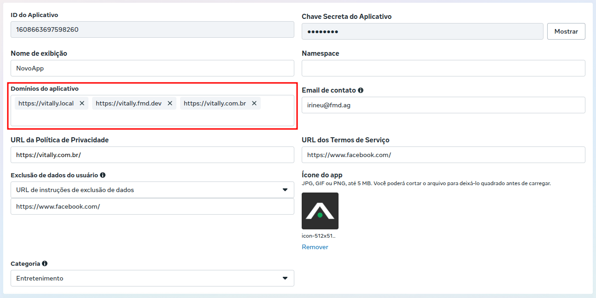

Ainda em básico, vá em **Adicionar plataforma** > Website

Adicione a url de produção.

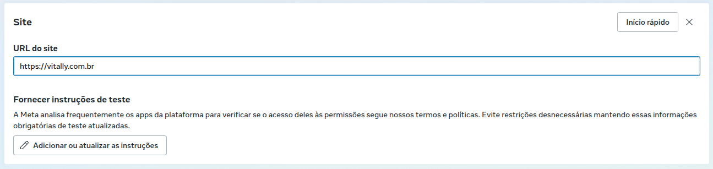

Na lateral esquerda, vá em Funções do app > Funções

Vamos em **Adicionar pessoas**

Escolhemos **Testador do Instagram** e enviamos o convite para a conta que iremos consumir.

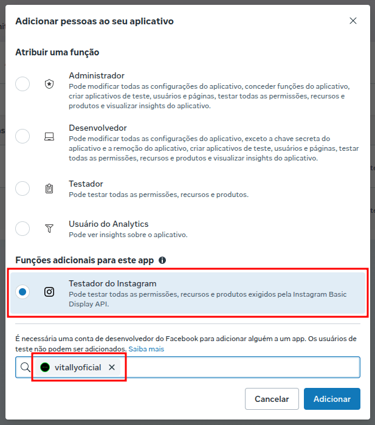

Agora no Instagram, vamos na conta que acabamos de enviar o convite.

Clicamos em Mais > Configurações (https://www.instagram.com/accounts/edit/)

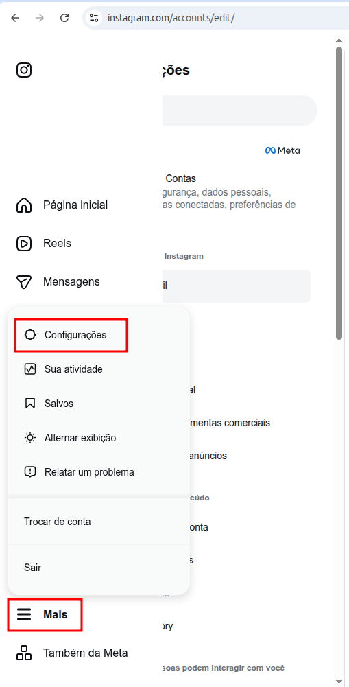

Vamos em **Seu app e suas mídias** > Permissões do site > Apps e sites

Aceite em **Convites do testador**.

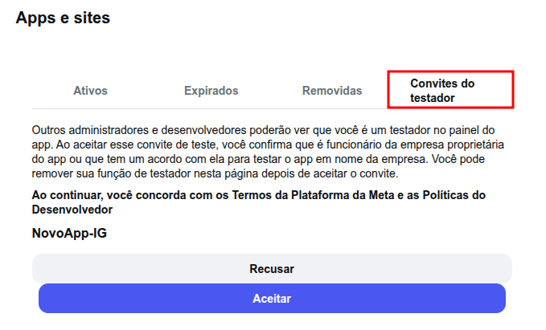

Com o convite aceito, preencha o `.env`, crie o perfil (`php artisan instagram-feed:profile YourProfile`) e clique em **Renovar token do Instagram** no dashboard do painel para autorizar a conta.

## Permissões

O pacote não registra Resource, portanto não adiciona permissões ao controle por Grupos. O widget é exibido no dashboard do painel.

## Licença

Este pacote é software livre e está disponível nos termos da licença MIT.
